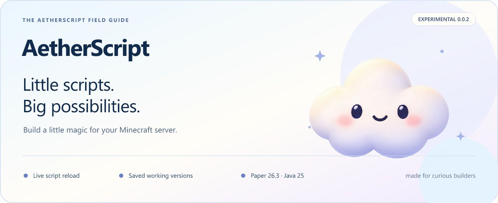

<p align="center"></p>

<p align="center"><a href="https://github.com/MistDig/AetherScript/releases/tag/v0.0.2"><b>Download 0.0.2</b></a> · <a href="https://github.com/MistDig/AetherScript/wiki">Explore the wiki</a> · <a href="CHANGELOG.md">Changelog</a> · <a href="docs/roadmap.md">Roadmap</a></p>

[](https://github.com/MistDig/AetherScript/actions/workflows/ci.yml)
[](https://github.com/MistDig/AetherScript/releases)
[](LICENSE)

An open-source Minecraft scripting engine with **live hot reloading**, saved working revisions and a path toward secure, vendor-neutral AI tooling. Target: **Paper 26.3 build 245 · Java 25**.

## What's in 0.0.2?

- Strict YAML/JSON compiled to immutable, permission-checked message actions.
- Live reload with invalid edits preserving the running script.
- Saved successful revisions, startup recovery and local rollback; five versions per feature by default.
- Clear editable-file versus running-version status, field/line/column errors, history and bounded diffs.
- A separate **offline read-only MCP** validator. AI deployment and a server bridge are absent.

This is an experimental message-only release. Events, block health, variables, UI and a human DSL remain future work. Published versions begin at 0.0.1; the original roadmap labels describe engineering milestones, not release numbers.

## Get started

1. Stop Paper, back up existing AetherScript data, and install **AetherScript-0.0.2.jar** from the release. Keep only one plugin JAR installed.
2. Start with Java 25 and wait for `Ready. Restored ...`. A new install creates and activates `plugins/AetherScript/scripts/hello-ai.yml`.
3. Run `/ais run hello-ai`. Players need `aetherscript.example.hello` (operators by default).
4. Edit its quoted `text`, save, then `/ais validate hello-ai` and `/ais reload hello-ai`.
5. Run it again: the new message is live without restarting Paper.

Console commands omit `/`. Administration requires `aetherscript.admin`. There is no automatic file watcher or `/helloai` alias; `commands.name` is reserved metadata.

```text
/ais status [feature]
/ais list
/ais validate [feature]
/ais reload [feature]
/ais run <feature>
/ais history <feature>
/ais diff <feature>
/ais rollback <feature>
```

You always edit `scripts/<id>.yml`, `.yaml` or `.json`; one format per ID. Internal revisions are managed by the engine. Invalid reloads show the edit target and preserve working source. Rollback does not overwrite your edit and stays selected across restarts until explicit reload.

**Upgrade change:** valid files now autoactivate on startup. Invalid/missing files can recover saved revisions. 0.0.1 had no durable history, so your first successful 0.0.2 activation creates it. Full `/ais reload` replaces the whole registry and retires features whose files were removed; targeted reload affects one feature.

[Installation](https://github.com/MistDig/AetherScript/wiki/Getting-Started) · [Language](https://github.com/MistDig/AetherScript/wiki/Language-Reference) · [Recovery](https://github.com/MistDig/AetherScript/wiki/Revisions-and-Recovery) · [Test checklist](https://github.com/MistDig/AetherScript/wiki/Testing-0.0.2)

## Build and verification

Set `JAVA_HOME` to JDK 25:

```powershell
.\gradlew.bat clean check build
python integration-tests/mcp_stdio.py
```

Linux/macOS: `./gradlew clean check build`. Gradle 9.1.0 wrapper, dependency locks and checksums are committed. First build needs network access.

- `plugin-paper/build/libs/plugin-paper-0.0.2.jar`: standalone plugin; do not install the thin JAR.
- `gateway-mcp/build/libs/gateway-mcp-0.0.2.jar`: separate executable MCP process.

Actual local verification: **70 tests passed**, packaged MCP passed, and **27 Paper console checks across five boots and 100 distinct reloads passed**. Tests cover invalid edits, restart, rollback, retention, corrupt storage and abruptly halted JVM saves. See [evidence](docs/evidence/0.0.2) and [testing notes](docs/testing.md). Connected-player 0.0.2 checks, Purpur, named MCP clients and performance benchmarks remain open.

## Read-only MCP

Run `java -jar AetherScript-MCP-0.0.2.jar` separately, using an absolute path in your stdio client configuration. Do not put it in Paper's plugin directory.

Protocol `2025-06-18`: initialization, ping, discovery, `aether_capabilities`, `aether_server_status` (explicitly offline), and `aether_validate` for supplied source. No model API key is needed by the gateway. No live server reads, file tools, arbitrary console commands or deployment are available. Universal describes protocol design; named client interoperability is [not yet verified](docs/mcp-clients.md).

## Reliability and performance

The engine stages content and atomically replaces a checksummed manifest. Only committed revisions participate in recovery. Corrupt manifests block startup; individual damaged sources can fall back to older valid copies. A save/audit failure attempts compensation; uncertain recovery quarantines operations. Registry rollback does not undo messages already sent.

Process-crash tests are not a power-loss guarantee; filesystem directory flush support varies. Keep owner backups of the whole data directory. Local audits are not tamper-proof and need disk monitoring/rotation. Host administrators and installed Java plugins remain trusted.

AetherScript shares Paper's JVM GC. It does not force or disable collection. Parsing and disk I/O run outside normal invocation; actions and queues are bounded. Zero allocation, GC-free execution and zero lag are not claimed. See [architecture](docs/architecture.md), [security](SECURITY.md) and [performance](docs/performance.md).

## Contributing and releases

Every completed change batch gets a version, changelog and GitHub release with plugin/MCP JARs, source archive and SHA-256 checksums. Published tags/assets are not overwritten. See [release procedure](docs/releasing.md) and [contributing](CONTRIBUTING.md).

Wiki sources and cloud artwork live in `docs/wiki/` and `docs/assets/`. Runtime worlds, caches and credentials are excluded. Apache-2.0.
