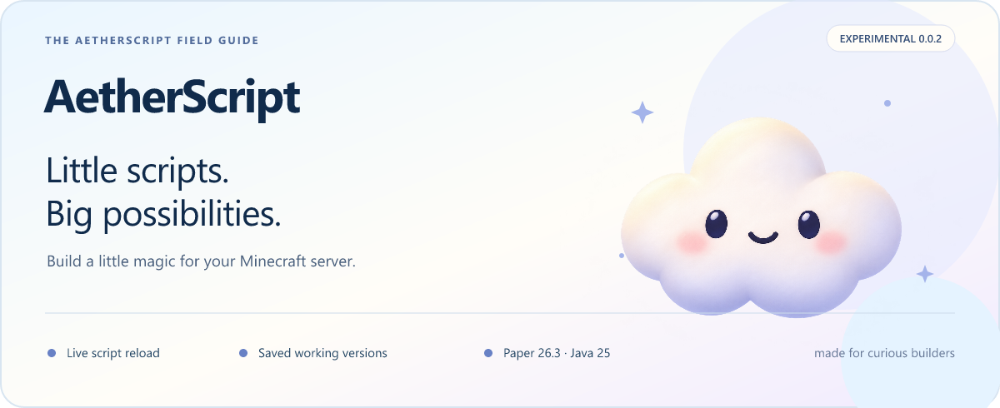

<p align="center"></p>

<p align="center"><a href="https://github.com/MistDig/AetherScript/releases/tag/v0.0.18"><b>Download 0.0.18</b></a> · <a href="https://mistdig.github.io/AetherScript/">Explore the docs</a> · <a href="CHANGELOG.md">Changelog</a> · <a href="docs/roadmap.md">Roadmap</a></p>

[](https://github.com/MistDig/AetherScript/actions/workflows/ci.yml)
[](https://github.com/MistDig/AetherScript/releases)
[](LICENSE)

An open-source Minecraft scripting engine with **live hot reloading**, saved working revisions and a path toward secure, vendor-neutral AI tooling. Target: **Paper 26.3 build 245 · Java 25**.

## Language foundation and the month goal

The [17 November–17 December plan](docs/ecosystem/month-goal-2026-11-17.md) prioritizes the language, core Minecraft APIs and addon foundations, then gameplay adapters and reliability, with MCP expansion last. AI authors get canonical syntax, a machine-readable contract and precise errors; humans need not learn the DSL to request features. The one-month goal is a broad plugin language, with explicit acceptance gates rather than a guarantee of Java API parity. This first 0.0.18 batch adds bounded immutable maps/sets and compiler registry injection; build verification is pending the release checks. Existing MCP validation uses the shared core, with no new tools or relay changes.

## Native commands and approved tests introduced in 0.0.17

Native player commands can read immutable locations, persist homes, wait a bounded number of server ticks and teleport the invoking player. Install [homes.aether](examples/homes.aether) locally with console approval, or authorize your AI in the browser to create and activate native commands; see the [homes guide](https://mistdig.github.io/AetherScript/guide/language.html#owner-approved-homes-commands-current-implementation). Fresh 0.0.17 browser approval selects all or selected native IDs, an execution capability set and optionally one test-player UUID. The AI can create, edit and activate native features within that grant. The execution set persists for installed features after AI disconnect. Console `ais permit` and `ais restrict` remain manual overrides that browser grants cannot exceed. Legacy personal-relay and older browser grants stay message-only until fresh approval. This command-only slice does not complete the planned event, UI, general gameplay or optional model ecosystem. Verification claims below retain their original versions.

## Connect through your browser

Install the plugin, run `ais connect` in the Minecraft server console, and open the private link on your AI computer. Choose your app, approve all native scripts or selected IDs, select execution capabilities and optionally select a test player in the browser. Hosted clients use one HTTPS MCP URL; they need no separate gateway JAR or Java installation on the AI computer. Each server creates its own identity automatically. The shared service handles the connection.

For Claude, open Customize > Connectors, add the displayed HTTPS MCP URL and choose Register automatically. For Cursor, use the page's installation link. Codex users can use the page's Windows setup ZIP or the documented CLI add/login commands. Complete authorization in the browser holding your private console link. Client steps and dated primary sources are recorded in [MCP clients](docs/mcp-clients.md). [Step-by-step guide](https://mistdig.github.io/AetherScript/guide/security.html)

Use `ais connections` to see grants and `ais disconnect` to revoke access. Normal server restarts preserve approved connections. Disconnect revokes remote access and pending tests; installed scripts and persisted capability grants keep working. The service can see scripts/results, and connections expire after 30 days.

## Runtime inputs in 0.0.7

Declare `arg name: text` at the beginning of a native command, then use that value in expressions and conditions. `/ais run greet MistDig` and `/ais run greet Alex` evaluate the same installed script with fresh values. Integer and boolean arguments can have defaults. Quoted text supports spaces. See the [language guide](https://mistdig.github.io/AetherScript/guide/language.html).

The documentation site includes Copy docs link for AI and Download docs. The full text contains every wiki guide and the machine-readable language contract for that release.

## Lists and storage foundations in 0.0.12

Use typed immutable lists, indexing, `length`, `append`, and `for` iteration to process data. Function parameters can have trailing constant defaults. [scores.aether](examples/scores.aether) totals a typed list through reusable functions.

The core Java API now offers a separate SQLite variable backend with transaction/CAS tests and a pinned JDBC provider. At that release storage was not exposed to scripts. The current homes slice binds own-location storage on Paper; general script persistence remains an M2 task.

## Runtime foundations in 0.0.11

Use `var` and `set` for mutable invocation locals, `while` or `repeat` for bounded iteration, and typed `fn` helpers for reusable logic. [countdown.aether](examples/countdown.aether) demonstrates functions and loops; its messages are immediate. The current homes slice separately supplies bounded command delays. Each feature registers its real command name with collision protection and owned removal.

The [M1–M3 checkpoint](docs/ecosystem/halfway-milestone.md) records the ongoing halfway goal. This release is a tested foundation slice, not completion of those phases.

## Native script language

The `.aether` frontend supports immutable `let` and mutable `var` locals, typed scalar expressions, `if`/`else`, bounded `while`/`repeat`, `break`/`continue`, and typed reusable functions with `return`. Legacy scripts without arguments or advanced constructs retain preparation-time evaluation. Arguments, mutable locals, loops or function declarations select invocation-time evaluation with fresh local values. All paths type-check before activation; loops and calls share an 8192-step budget and 32-message output cap.

```text
feature hello-ai version "1.0.0"
command helloai permission "aetherscript.example.hello" sender any {
  let greeting = "Hello"
  let count = 2 + 3
  if count == 5 {
    send greeting + " from AetherScript!"
  } else {
    send "Unexpected count"
  }
}
```

Save this as `scripts/hello-ai.aether`, using one source file for that feature ID. Validate, reload and run it with the existing `/ais` commands. The [language guide](https://mistdig.github.io/AetherScript/guide/language.html) covers types, scope, operators and preparation limits.

The [documentation website](https://mistdig.github.io/AetherScript/) includes local search, sidebar guides, dark mode and mobile navigation. The [ecosystem inventory](docs/ecosystem/README.md) tracks the brief's concrete capabilities, evidence and dependency order. The [halfway milestone](docs/ecosystem/halfway-milestone.md) tracks M1–M3. Scalar runtime locals, loops, functions and owned direct commands are implemented foundations. Lists and the narrow location/state/delay/self-teleport bindings are available; The 0.0.18 foundation adds immutable maps/sets and a public compiler registry-injection seam; records, events, broader gameplay and persistence, menus and the complete addon loader/event/serializer SDK remain open.

## What the engine does

- YAML/JSON retain the immutable message model; native `.aether` also supports locally approved host command operations.
- Live reload with invalid edits preserving the running script.
- Saved successful revisions, startup recovery and local rollback; five versions per feature by default.
- Clear editable-file versus running-version status, field/line/column errors, history and bounded diffs.
- A separate MCP gateway with offline validation/exact message tests, opt-in loopback status and scoped remote `.aether` authoring.

This experimental implementation supports sender messages, preparation-time legacy logic, invocation-time control flow and a locally approved player-command host slice. A typed, versioned persistent-variable service exists in core, with atomic JSON and a separate SQLite backend; Paper binds own-location storage for homes. Events, block health, gameplay APIs and UI remain in the [dependency backlog](docs/ecosystem/backlog.md). Published versions begin at 0.0.1; milestone labels describe engineering phases.

## Get started

1. Stop Paper, back up existing AetherScript data, and install **AetherScript-0.0.18.jar** from the release. Keep only one plugin JAR installed.
2. Start with Java 25 and wait for `Ready. Restored ...`. A new install creates and activates `plugins/AetherScript/scripts/hello-ai.yml`.
3. Run `/ais run hello-ai`. Players need `aetherscript.example.hello` (operators by default).
4. Edit its quoted `text`, save, then `/ais validate hello-ai` and `/ais reload hello-ai`.
5. Run it again: the new message is live without restarting Paper.

Console commands omit `/`. Administration requires `aetherscript.admin`. Each active feature also registers its declared command name, such as `/helloai`. Foreign command collisions reject activation; renamed and retired commands are removed. There is no automatic file watcher. Client command-tree refresh and suggestions remain unverified.

```text
/ais status [feature]
/ais list
/ais validate [feature]
/ais reload [feature]
/ais run <feature>
/ais history <feature>
/ais diff <feature>
/ais rollback <feature>
```

You edit `scripts/<id>.yml`, `.yaml`, `.json` or `.aether`; use one format per ID. Internal revisions are managed by the engine. Invalid reloads show the edit target and preserve working source. Rollback does not overwrite your edit and stays selected across restarts until explicit reload.

**Upgrade change:** valid files now autoactivate on startup. Invalid/missing files can recover saved revisions. 0.0.1 had no durable history, so the first successful activation on 0.0.2 or later creates it. Full `/ais reload` replaces the whole registry and retires features whose files were removed; targeted reload affects one feature.

[Installation](https://mistdig.github.io/AetherScript/guide/getting-started.html) · [Language](https://mistdig.github.io/AetherScript/guide/language.html) · [Recovery](https://mistdig.github.io/AetherScript/guide/recovery.html) · [Test checklist](https://mistdig.github.io/AetherScript/guide/testing.html)

## Build and verification

Set `JAVA_HOME` to JDK 25:

```powershell
.\gradlew.bat clean check build
python integration-tests/mcp_stdio.py
```

Linux/macOS: `./gradlew clean check build`. Gradle 9.1.0 wrapper, dependency locks and checksums are committed. First build needs network access.

- `plugin-paper/build/libs/plugin-paper-0.0.18.jar`: standalone plugin; do not install the thin JAR.
- `gateway-mcp/build/libs/gateway-mcp-0.0.18.jar`: separate executable MCP process.

Historical 0.0.17 verification: the clean build passed **286 Java tests**, with nine relay regressions and the packaged authoring/storage/compatibility checks passing. Seven browser/OAuth/MCP workflow groups passed across two Paper boots, including native authoring without manual permits, real-player tests and effect receipts, isolation, permission loss, restart and revocation. [0.0.17 evidence](docs/evidence/0.0.17/) identifies protocol testing separately from actual AI-client certification.

Historical 0.0.16 baseline: The 0.0.16 implementation passed **274 Java tests** with no failures, eight relay regressions, packaged CLI/MCP authoring, both SQLite packaging/license checks, nine wiki examples and seven published 0.0.11 semantic-hash comparisons. The documentation production build and link/search checks passed. [0.0.16 evidence](docs/evidence/0.0.16/) separates real-server checks and remaining limits.

Paper 26.3 build 245 passed 23 homes checks across two boots with two synthetic 26.1 clients translated through ViaProxy 3.4.14. The fixture verifies per-player persistence, delayed teleport, replacement/permission/capability/disconnect cancellation and restart. This is not native 26.3 UI or two-PC verification.

Historical baseline: The 0.0.12 clean build passed **254 Java tests**. Both packaged JARs passed native SQLite storage/license checks; the CLI/MCP, nine wiki examples and seven published 0.0.11 semantic-hash compatibility cases pass. Paper passed 19 runtime/command checks over two boots. [0.0.12 evidence](docs/evidence/0.0.12) records exact scope. The five-boot/100-reload recovery run and seven relay tests remain attributed to 0.0.11 in [test notes](docs/testing.md). Connected-player command-tree/suggestions, client certification, the owner's two-PC Feather setup, Purpur and quantitative performance measurements remain incomplete.

## MCP connection

The default connection uses the shared hosted MCP at `https://aetherscript-relay.mistdig143.workers.dev/mcp`. Start from `ais connect` to establish the owner browser session before your AI app begins OAuth. Approval limits the connection to all native scripts or the selected feature IDs and the fixed script operations, execution capability set and optional owner-selected test player. Native tests report real effects and may require polling aether_scripts_test_status with id and testId.

The local gateway JAR retains offline validation, synthetic message tests, the 0.0.5 loopback status mode and the 0.0.6 personal-relay mode. It is optional for hosted pairing. [Client verification](docs/mcp-clients.md) records exactly which checks ran.

## Reliability and performance

The engine stages content and atomically replaces a checksummed manifest. Only committed revisions participate in recovery. Corrupt manifests block startup; individual damaged sources can fall back to older valid copies. A save/audit failure attempts compensation; uncertain recovery quarantines operations. Registry rollback does not undo messages already sent.

Process-crash tests are not a power-loss guarantee; filesystem directory flush support varies. Keep owner backups of the whole data directory. Local audits are not tamper-proof and need disk monitoring/rotation. Host administrators and installed Java plugins remain trusted.

AetherScript shares Paper's JVM GC. It does not force or disable collection. Parsing and disk I/O run outside normal invocation; argument binding and runtime evaluation occur during invocation with bounded work, actions and queues. Zero allocation, GC-free execution and zero lag are not claimed. See [architecture](docs/architecture.md), [security](SECURITY.md) and [performance](docs/performance.md).

## Contributing and releases

Every completed change batch gets a version, changelog and GitHub release with plugin/MCP JARs, source archive and SHA-256 checksums. Published tags/assets are not overwritten. See [release procedure](docs/releasing.md) and [contributing](CONTRIBUTING.md).

Website source lives in `site/`; guides are generated from `docs/wiki/` so the docs and wiki share their content. Cloud artwork lives in `docs/assets/`. See [website development](site/README.md). Runtime worlds, caches and credentials are excluded. Apache-2.0.
