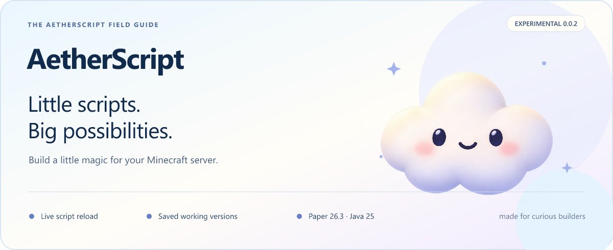

> **Our new documentation home is live:** [Explore AetherScript →](https://mistdig.github.io/AetherScript/)
> Searchable guides, dark mode, and a little more room for the clouds.

<p align="center"></p>

<p align="center"><a href="https://github.com/MistDig/AetherScript/releases/tag/v0.0.11"><b>Download 0.0.11</b></a> &nbsp; · &nbsp; <a href="https://github.com/MistDig/AetherScript/wiki/Getting-Started">Start building</a> &nbsp; · &nbsp; <a href="https://github.com/MistDig/AetherScript/wiki/Commands">Commands</a> &nbsp; · &nbsp; <a href="https://github.com/MistDig/AetherScript/wiki/Roadmap">What's next</a></p>

---

## A small beginning. Room to grow.

AetherScript is an open-source Minecraft scripting engine for **Paper 26.3**, with live script reloads and permission-checked behavior. Change a script, reload that feature, and try it immediately.

**0.0.2 adds a safety net:** successful revisions are saved, invalid edits leave your working script running, and diagnostics tell you which file to fix. One editable file. Five saved versions by default.

> [!NOTE]
> This is an experimental, **message-only release**. Write a command in [native AetherScript](https://github.com/MistDig/AetherScript/wiki/AI-Authoring), YAML or JSON. Gameplay events and block health are planned. Scoped remote authoring is opt-in; the server console selects the feature IDs an agent can manage.

## Pick your path

| 🌱 Make something | ☁ Keep it working | 🔭 Look ahead |
| :--- | :--- | :--- |
| [Install & run](https://github.com/MistDig/AetherScript/wiki/Getting-Started) | [Saved versions & rollback](https://github.com/MistDig/AetherScript/wiki/Revisions-and-Recovery) | [Gameplay roadmap](https://github.com/MistDig/AetherScript/wiki/Roadmap) |
| [Language & examples](https://github.com/MistDig/AetherScript/wiki/Language-Reference) | [Errors & differences](https://github.com/MistDig/AetherScript/wiki/Diagnostics-and-Diffs) | [Security & MCP](https://github.com/MistDig/AetherScript/wiki/Security-and-MCP) |
| [Command desk](https://github.com/MistDig/AetherScript/wiki/Commands) | [Test your upgrade](https://github.com/MistDig/AetherScript/wiki/Testing-0.0.2) | [Performance](https://github.com/MistDig/AetherScript/wiki/Performance) |

## Your everyday loop

```text
Edit scripts/hello-ai.yml
        ↓
/ais validate hello-ai
        ↓
/ais reload hello-ai
        ↓
/ais run hello-ai
```

If validation fails, fix the **same editable file**. The running saved revision stays active. `/ais status hello-ai` shows both states; `/ais diff hello-ai` compares them.

| Available now | Still future work |
| :--- | :--- |
| Explicit live reload and validated AetherScript, YAML and JSON | Automatic file watching and event handlers |
| Saved revisions, recovery and rollback | World-state undo and remote transactions |
| File/line/column diagnostics and diffs | Full editor language-server support |
| Offline validation, local tests and scoped relay authoring | General console execution and unrestricted server access |

**Tested target:** Paper 26.3 build 245 · Java 25. Other forks and named MCP clients have separate verification gates.

---

<p align="center">A little cloud. A careful engine. Your next idea.<br><a href="https://github.com/MistDig/AetherScript">Source</a> · <a href="https://github.com/MistDig/AetherScript/releases">Releases</a> · <a href="https://github.com/MistDig/AetherScript/blob/v0.0.7/CHANGELOG.md">Changelog</a> · Apache-2.0</p>

## Learn or connect

[Write your first script](https://github.com/MistDig/AetherScript/wiki/Language-Reference) · [Connect your AI](https://github.com/MistDig/AetherScript/wiki/Security-and-MCP) · [Fix a problem](https://github.com/MistDig/AetherScript/wiki/Troubleshooting)

Use Copy docs link for AI on the [documentation website](https://mistdig.github.io/AetherScript/), or copy [the complete 0.0.7 guide](https://mistdig.github.io/AetherScript/releases/0.0.11/llms-full.txt) into your AI app. Human pages and the complete text share the same sources.
